# 色差累積ビューア（deltae-calc）

色見本 → 承認塗板 → 製品 のように色を何段か引き継いでいくと、各段で生じた小さな色のずれが積み重なり、最初の色との色差が大きくなることがあります。
このツールは、測色計の値を入れるだけで「最後の試料は最初の色からどれだけずれているか」「ずれが積み上がっているのか、打ち消し合っているのか」「許容差まであとどれくらい余裕があるか」を図で示します。
2 つの色のちょうど中間の色（たとえば上限見本と下限見本の中心）を求めることもできます。

**今すぐ使う → https://kotaooka.github.io/deltae-calc/**

- ブラウザだけで動きます。インストールやユーザー登録は不要です
- 入力した数値はお使いの端末の中だけで計算し、外部には送信しません
- スマホ・タブレット・PC のどれでも使えます

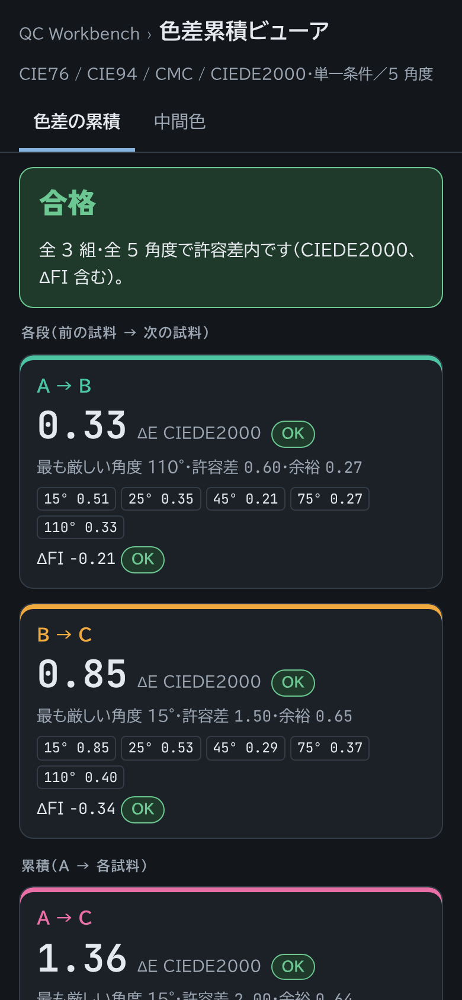

---

## 画面の構成

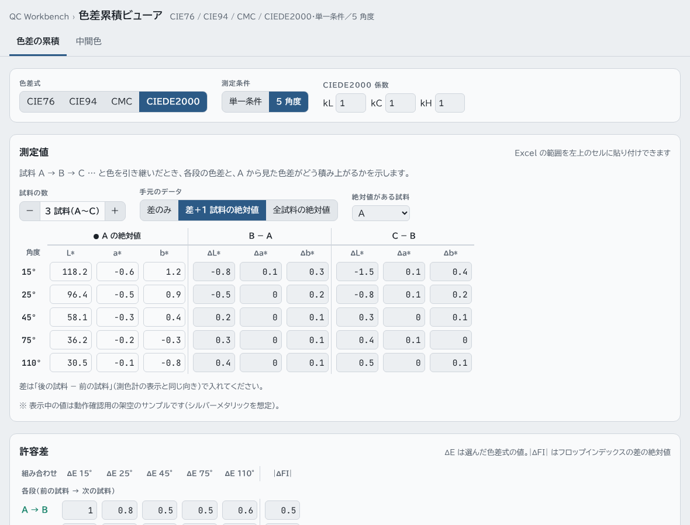

画面上部のタブで計算の種類を切り替えます。

| タブ | できること |
|---|---|
| 色差の累積 | 試料 A → B → C … と引き継いだときの、各段の色差と A から見た色差を判定する |
| 中間色 | 色 A と色 B の中間の色 M を求める |

その下の「計算条件」は 2 つのタブで共通です。

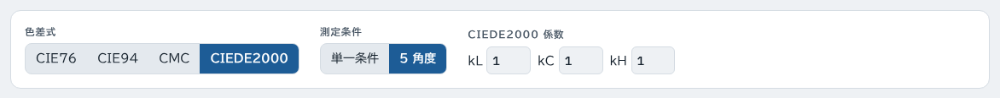

| 項目 | 選べるもの |
|---|---|
| 色差式 | CIE76（ΔE\*ab）／ CIE94 ／ CMC(l:c) ／ CIEDE2000（ΔE00）。取引先の規格で指定された式を選んでください |
| 測定条件 | **単一条件**：SCI・SCE など 1 つの条件で測った値（名称は自由に変えられます） **5 角度**：メタリック・パール塗装用の多角度測色計の値（15°・25°・45°・75°・110°） |

試料は A、B、C … と記号で表します。色見本・承認塗板・製品など、自分の工程に当てはめて読んでください。

---

## 色差の累積

### 1. 測定値を入れる

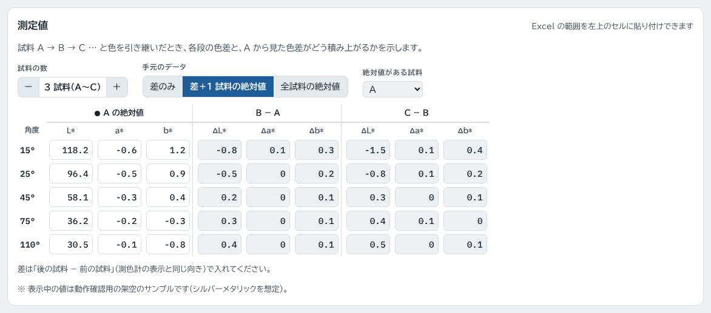

- **試料の数**：「−」「＋」で 2〜6 個（A〜F）に変えられます
- **手元のデータ**：持っている測定値の形を選びます

| 選択 | 入力するもの | できること |
|---|---|---|
| 差のみ | 各段の差（B − A、C − B …）の ΔL\* Δa\* Δb\* | CIE76 での判定、ずれの向き |
| 差＋1 試料の絶対値 | 各段の差と、どれか 1 つの試料の L\* a\* b\*（どの試料かは「絶対値がある試料」で選ぶ） | すべての色差式、フロップインデックス、色見本 |
| 全試料の絶対値 | すべての試料の L\* a\* b\* | すべての色差式、フロップインデックス、色見本（差は自動で計算） |

「差のみ」で CIE76 しか選べないのは、CIE94・CMC・CIEDE2000 が「元の色が鮮やかか、明るいか」で重みを変える式で、差だけでは計算できないためです。

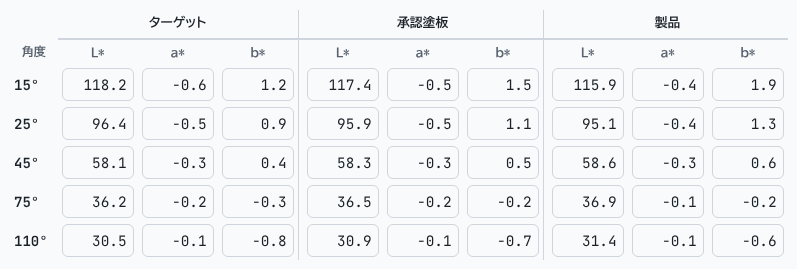

途中で選択を切り替えても、入力済みの値は同じ色を表すように引き継がれます（「差のみ」から切り替えたときは、絶対値を入れ直してください）。

### 2. 許容差を入れる

組み合わせごとに許容差を入れます。

- **各段**：A → B、B → C … （前の試料に対する次の試料の色差）
- **累積**：A → C、A → D … （最初の試料 A に対する色差）

5 角度のときは、フロップインデックスの差（|ΔFI|）の許容差も入れられます。

### 3. 判定を見る

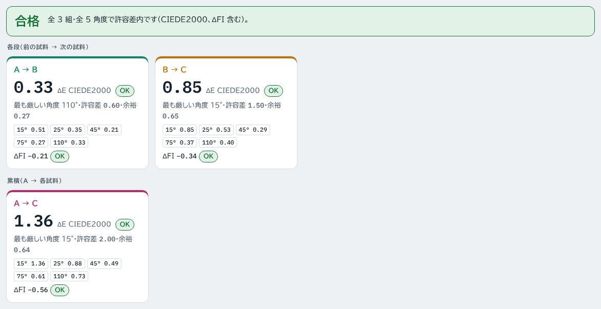

- 一番上に **合格 / NG** と、NG になった組み合わせ・角度を表示します
- カードは組み合わせごとの色差です。5 角度のときは、許容差に対して最も厳しい角度の値を大きく表示し、下に全角度の値を並べます
- 許容差の 80 % を超えると「余裕小」と表示します

試料を増やすと、各段と累積のカードがそれぞれ増えます（下は 4 試料の例）。

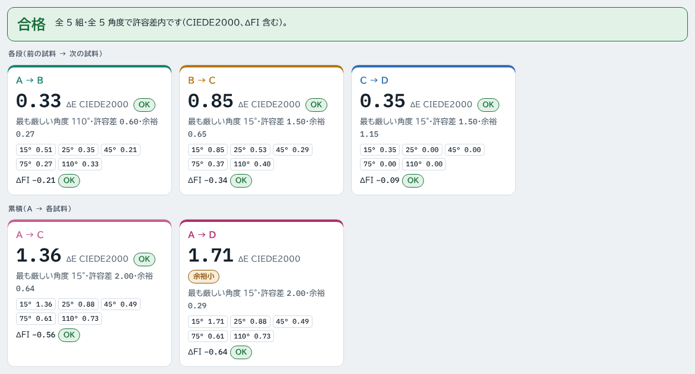

### 4. 角度別の色差とフロップインデックス（5 角度のとき）

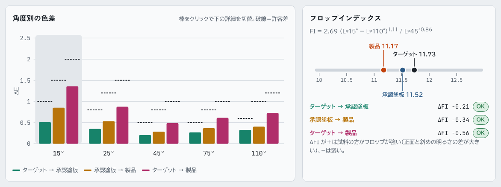

- **角度別の色差**：角度ごとに全組み合わせの色差を並べます。黒い破線が許容差です。棒をクリックすると、下の「詳細」がその角度に切り替わります
- **フロップインデックス（FI）**：見る角度によって明るさがどれだけ変わるか（メタリック感の強さ）を表す値です。ソリッド塗装は 0、メタリック・パールは 10〜17 程度になります。ΔFI がプラスなら、後の試料の方がメタリック感が強いことを表します

### 5. 詳細を見る

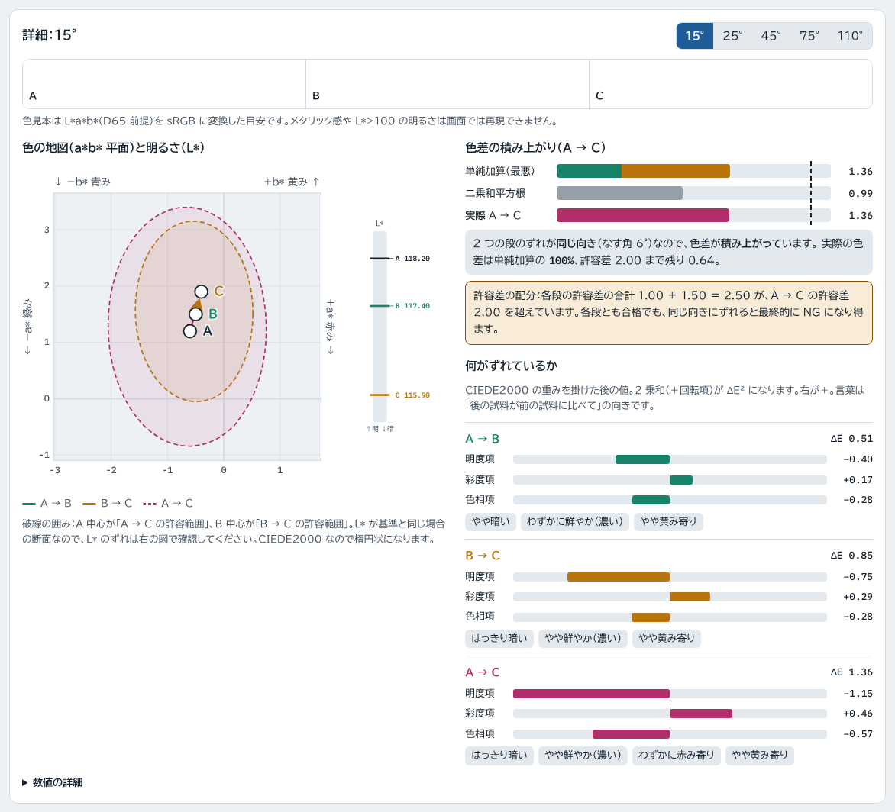

- **色見本**：入力した値を画面の色で再現した目安です（メタリック感は再現できません）
- **色の地図（a\*b\* 平面）**：右に行くほど赤み、上に行くほど黄みが強い色です。矢印は色が引き継がれた順番で、破線の囲みが許容範囲です。最後の試料の点が A を中心とする囲みの外に出ると、A に対して NG です
- **明るさ（L\*）**：右の縦棒で、各試料の明るさを比べます
- **色差の積み上がり**：各段の色差を足した値（最悪の場合）と、A から最後の試料までの実際の色差を比べ、ずれが「積み上がっている」「打ち消し合っている」かを文章で示します
- **許容差の配分**：各段の許容差の合計が、A → 最後の試料の許容差を超えていると警告します。この場合、どの段も合格なのに最終的に NG になることがあります
- **何がずれているか**：明るさ・鮮やかさ・色合いのどれが色差の原因かを、棒グラフと言葉（「やや暗い」「わずかに黄み寄り」など）で示します

---

## 中間色

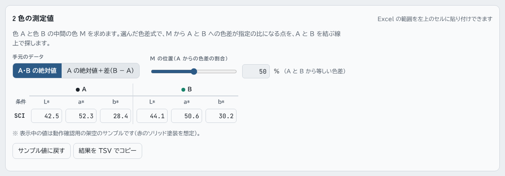

1. **手元のデータ**：A と B の L\* a\* b\* を両方入れるか、A の L\* a\* b\* と差（B − A）を入れるかを選びます
2. **M の位置**：50 % なら、A と B から等しい色差になる「ちょうど中間」の色を求めます。たとえば 30 % にすると、A 寄りの色（M → A の色差が A → B 全体の 30 % 相当）になります
3. 測定値を入れると、すぐに結果が出ます

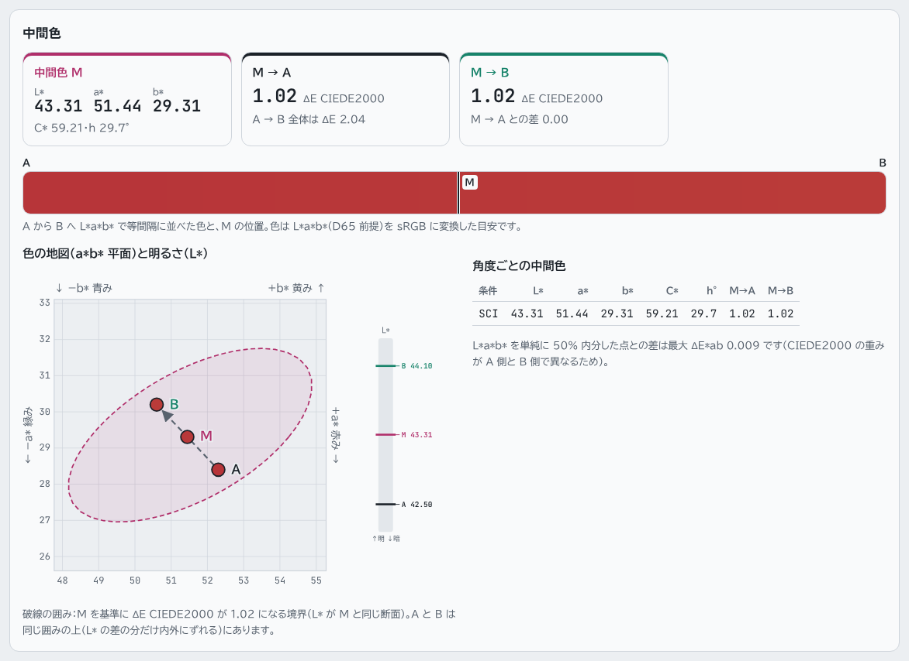

- **中間色 M**：M の L\* a\* b\*、彩度 C\*、色相角 h
- **M → A、M → B**：選んだ色差式での、M から A・B への色差
- **グラデーション**：A から B への色の変化と、M の位置
- **色の地図**：A・B・M の位置と、M から等しい色差になる境界
- **角度ごとの中間色**：5 角度のときは、角度ごとに求めた M を表にします。フロップインデックスも表示します

CIE76 では M は A と B の L\*a\*b\* を単純に平均した色と一致します。CIE94・CMC・CIEDE2000 は色によって重みが変わるため、単純な平均とわずかにずれます（画面に差を表示します）。

---

## アプリとして入れる（オフラインでも使えます）

ホーム画面やデスクトップに追加すると、アプリのように起動でき、一度開いたあとは通信がなくても使えます。

| 端末 | やり方 |
|---|---|
| Android（Chrome） | メニュー（︙）→「アプリをインストール」または「ホーム画面に追加」 |
| iPhone・iPad（Safari） | 共有ボタン →「ホーム画面に追加」 |
| Windows・Mac（Chrome / Edge） | アドレスバー右端のインストールボタン |

新しい版が公開されると、次に開いたときに自動で取り込みます。画面に「開き直すと反映されます」と出たら、一度閉じて開き直してください。

---

## 便利な使い方

- **Excel から貼り付け**：Excel で範囲を選んでコピーし、入力表の左上のセルに貼り付けると、まとめて入ります。並びは画面の表と同じ（角度が行、L\* a\* b\* が列）です。許容差の表にも貼り付けられます
- **結果を Excel へ**：「結果を TSV でコピー」を押すと、全角度・全組み合わせの結果をコピーします。Excel にそのまま貼り付けられます
- **入力は自動で保存**：入力した値はブラウザに保存され、次に開いたときも残っています。サンプル値に戻すときは「サンプル値に戻す」を押してください
- **タブを直接開く**：アドレスの末尾に `#mid` を付けると中間色のタブ、`#acc` を付けると色差の累積のタブが開きます

---

## 使うときの注意

- **差の向き**：差は「後の試料 − 前の試料」（B − A、C − B …）で入れてください。多くの測色計の表示と同じ向きです。逆向きで入れると、「積み上がり」と「打ち消し」の判定が逆になります
- **測定条件をそろえる**：絶対値を使うときは、同じ測色計・光源・視野で測った値を使ってください。1 つだけ別の機器で測った値（色見本の成績書の値など）を混ぜると、機器の差がそのまま色差に含まれます
- **色差式は混ぜない**：同じ数値でも、式が違えば色差は大きく変わります（CIEDE2000 の 1.0 と CIE76 の 1.0 は別物です）。許容差を決めたときと同じ式で判定してください
- **画面の色見本は目安**：モニターの設定によって見え方が変わります。目視の判定には実物を使ってください

---

## 開発者向けの情報

ファイル構成、計算式と検証方法、画像の作り直し方は [DEVELOPMENT.md](DEVELOPMENT.md) を参照してください。

---

## ライセンス

[MIT License](LICENSE)
